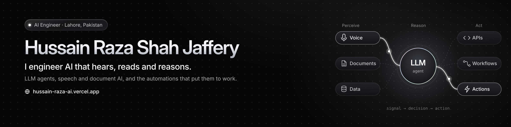

I'm an AI Engineer in Lahore, Pakistan. I build speech, document and language AI that runs in production, together with the FastAPI backends and n8n automations that put it to work.

**[Portfolio](https://hussain-raza-ai.vercel.app)** &nbsp;·&nbsp; **[LinkedIn](https://www.linkedin.com/in/hussain-raza-ai-engineer/)** &nbsp;·&nbsp; **[Email](mailto:hussainrazashah536@gmail.com)** &nbsp;·&nbsp; **[CV](https://hussain-raza-ai.vercel.app/Hussain_Raza_Shah_Jaffery_CV.pdf)**

### What I've built

| System | What it does |
| --- | --- |
| [**MedScribe AI**](https://hussain-raza-ai.vercel.app/work/medscribe-ai) | A doctor dictates for 30 seconds; a structured 7-field clinical record comes back in about 2 seconds, with an AI drug-safety review, on the hospital's own GPUs. 🔒 *Private repository* |
| [**Lab Report Extraction**](https://hussain-raza-ai.vercel.app/work/lab-report-extraction) | Unstructured PDF lab reports become structured, doctor-verified summaries before a telemedicine consultation. |
| [**Dr. Sara**](https://hussain-raza-ai.vercel.app/work/dr-sara) | An Urdu voice agent that takes a patient's medical intake in real time. 🔒 *Private repository* |
| [**Smart Query Routing**](https://hussain-raza-ai.vercel.app/work/smart-query-routing) | My final year project: classifies web and email queries, routes each one to the right department and drafts a reply. [Code](https://github.com/hussain-raza-ai/smart-query-routing-system) |
| [**University ERP & LMS**](https://hussain-raza-ai.vercel.app/work/university-erp-lms) | Admissions, fees, academics and exams in one self-hosted system. |

The code for Smart Query Routing is public. MedScribe AI and Dr. Sara live in private repositories because they contain hospital data; I'm happy to walk through the code in an interview. Every system is documented as a case study on my portfolio: the problem, how it works step by step, and the results.

### Tools I work with

**AI and LLMs:** MedGemma (4B, 27B), Google MedASR, Groq Whisper, GPT-4o-mini, Google Gemini, Anthropic Claude, LangChain, Pipecat, Edge TTS, Docling OCR

**Backend and automation:** Python, FastAPI, Pydantic, REST APIs, n8n, PostgreSQL, Supabase, MariaDB

**Infrastructure:** Linux, Docker, PyTorch (CUDA), on-premise GPU deployment, Vercel, Git

### Open to

AI engineering roles and projects where software has to hear, read or reason. The fastest way to reach me is [email](mailto:hussainrazashah536@gmail.com) or [LinkedIn](https://www.linkedin.com/in/hussain-raza-ai-engineer/).
